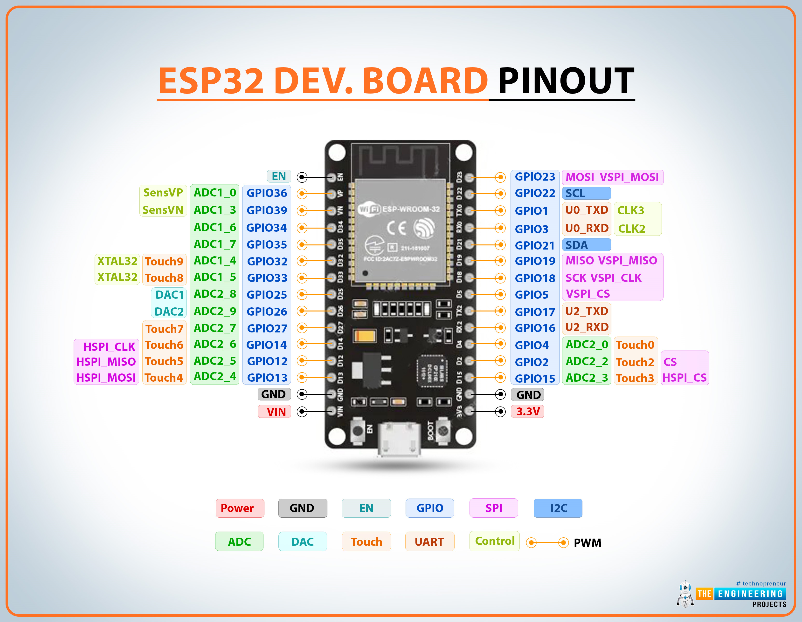
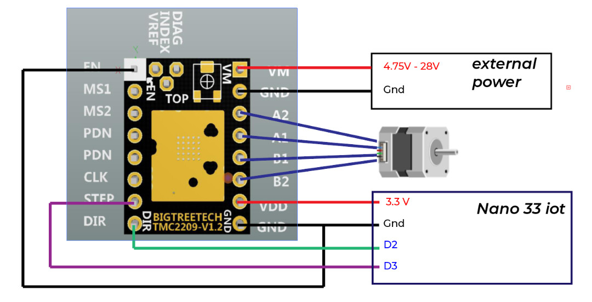
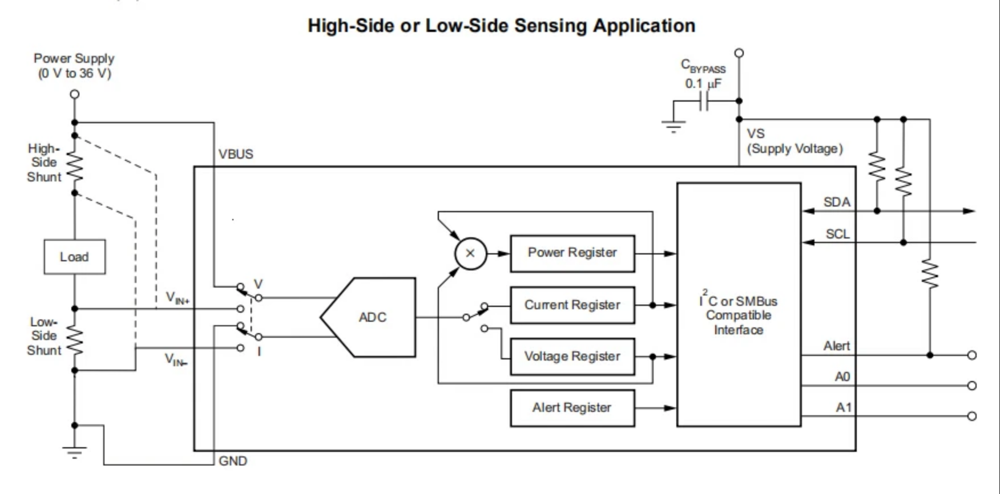
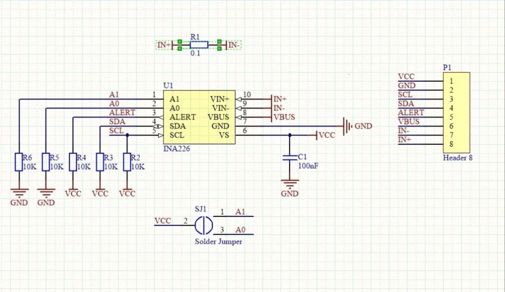

# ESP32 TMC2209 Stepper Driver & INA226 Power Monitor Example

An example project demonstrating how to control a **Trinamic TMC2209** stepper motor driver using an **ESP32** (30-pin Dev Board / NodeMCU-32S) via **STEP/DIR** and **single-wire UART** with the [TMCStepper](https://github.com/teemuatlut/TMCStepper) library, while monitoring the stepper motor's live bus voltage, shunt voltage, current draw, and power consumption using an **INA226** bi-directional current/power sensor over **I2C**.

---

## Hardware References

This project uses standard 30-pin ESP32 development boards (ESP32 Dev Module / NodeMCU-32S), a TMC2209 driver module, and an INA226 current/power sensor breakout board:

### ESP32 Pinout


### TMC2209 Driver Pinout


### INA226 High-Side Sensing & Module Schematic




---

## Wiring & Connections

### Pin Mapping Table

| Subsystem | ESP32 Pin Label | ESP32 GPIO | Module Pin | Function / Description |
| :--- | :--- | :--- | :--- | :--- |
| **TMC2209** | **D25** | `GPIO25` | `STEP` | Step pulse input |
| **TMC2209** | **D26** | `GPIO26` | `DIR` | Direction control |
| **TMC2209** | **D27** | `GPIO27` | `EN` | Driver Enable (**Active LOW**: LOW = Enabled, HIGH = Disabled) |
| **TMC2209** | **RX2** | `GPIO16` | `PDN_UART` | Direct connection to TMC2209 UART single-wire pin |
| **TMC2209** | **TX2** | `GPIO17` | `PDN_UART` | **Connect through a 1kΩ resistor** to `PDN_UART` (or to RX2) |
| **TMC2209** | **D14** *(opt)*| `GPIO14` | `DIAG` | StallGuard / diagnostic alert pin |
| **TMC2209** | **3V3** | `3.3V` | `VIO` | Logic voltage supply (3.3V) |
| **TMC2209** | **GND** | `GND` | `GND` (Logic)| Logic ground (common with ESP32) |
| **TMC2209** | Stepper 4-wire | — | `2B, 2A, 1A, 1B` | Stepper motor phase coils (A1/A2, B1/B2) |
| **INA226** | **3V3** | `3.3V` | `VCC` | Sensor logic power (3.3V, pulls up I2C to 3.3V) |
| **INA226** | **GND** | `GND` | `GND` | Ground (tied to common ground) |
| **INA226** | **D22** | `GPIO22` | `SCL` | I2C Clock (Hardware I2C default) |
| **INA226** | **D21** | `GPIO21` | `SDA` | I2C Data (Hardware I2C default) |
| **INA226** | — | — | `ALERT` | Optional alert output (leave unconnected or connect to GPIO) |
| **Power Bus** | *External +12V–24V* | — | `IN+` & `VBUS` | High-side power input from external DC supply |
| **Power Bus** | — | — | `IN-` | High-side sense output to TMC2209 `VMOT` |
| **Power Bus** | *External GND* | — | Common `GND` | Motor power supply ground (**must tie to ESP32 & driver GND**) |

---

### INA226 High-Side Sensing Wiring

The INA226 breakout module has an onboard **$0.1\,\Omega$ ($100\,\text{m}\Omega$) shunt resistor ($R_1$)** between `IN+` and `IN-`. To measure the stepper motor power supply without breaking the system ground reference, use **High-Side Sensing**:

```
 External Power Supply
    (+12V to +24V DC)
         |
         +-------------------------------------+
         |                                     |
         v                                     v
   INA226 [IN+]                          INA226 [VBUS]
         |                               (Bus Voltage Sensing)
    [ 0.1Ω Shunt ]
         |
   INA226 [IN-]
         |
         +-------------------------------------+
         |                                     |
         v                                     |
   TMC2209 [VMOT]                              |
         |                                     |
    +----+----+                                |
    | 100µF   | (Filter Capacitor)             |
    | Ceramic/|                                |
    | Electr. |                                |
    +----+----+                                |
         |                                     |
         v                                     v
    Common GND <=========================> External DC GND
         ^
         |
    ESP32 GND & INA226 GND
```

#### Detailed Connections:
1. **Power Supply Positive (+12V..24V)** connects to INA226 **`IN+`** and INA226 **`VBUS`**.
2. **INA226 `IN-`** connects to TMC2209 **`VMOT`** (with a $100\,\mu\text{F}$ capacitor across `VMOT` and `GND`).
3. **Common Ground**: Tie the External Power Supply **GND**, ESP32 **GND**, TMC2209 **GND**, and INA226 **GND** together.
4. **I2C Bus**:
   - `VCC` -> ESP32 `3.3V` (powering the INA226 from 3.3V sets onboard I2C pull-ups $R_2$ and $R_3$ safely to 3.3V).
   - `GND` -> ESP32 `GND`.
   - `SCL` -> ESP32 `GPIO22`.
   - `SDA` -> ESP32 `GPIO21`.
5. **I2C Address (`0x40`)**: With solder jumpers `SJ1` open (default), `A0` and `A1` are pulled to GND via onboard 10kΩ resistors ($R_5, R_6$), selecting address **`0x40`**.

---

### Single-Wire UART Connection

TMC2209 communicates over single-wire half-duplex UART on the `PDN_UART` pin:

```
ESP32 TX2 (GPIO17) -----[ 1kΩ Resistor ]-----+
                                             |
ESP32 RX2 (GPIO16) --------------------------+----> TMC2209 PDN_UART Pin
```

- Connect ESP32 **RX2 (GPIO 16)** directly to the TMC2209 **PDN_UART** pin.
- Connect ESP32 **TX2 (GPIO 17)** to the same **PDN_UART** line through a **1kΩ series resistor**.
- This enables bidirectional communication with HardwareSerial `Serial2` without signal contention.

---

### Driver Address & Sense Resistor
- **TMC2209 Address (`0b00`)**: Ensure `MS1` and `MS2` pins are tied to GND (default on standard BigTreeTech / StepStick modules).
- **TMC2209 Sense Resistor (`0.11Ω`)**: Standard SilentStepStick and BTT TMC2209 modules use $R_{SENSE} = 0.11\,\Omega$.
- **INA226 Shunt Resistor (`0.10Ω`)**: The INA226 module schematic specifies $R_1 = 0.1\,\Omega$.

> [!CAUTION]
> **NEVER plug or unplug the stepper motor while `VMOT` is powered!**  
> Inductive voltage spikes will instantly damage the TMC2209 driver. Always power down the motor power supply before making wiring changes.

---

## Features

- **Real-Time Power Telemetry (INA226)**:
  - Bus Voltage measurement ($V_{BUS}$, 0V–36V)
  - Shunt Voltage measurement ($V_{SHUNT}$, ±81.92 mV range)
  - Real-time stepper load current ($I$, mA)
  - Live power consumption ($P$, mW / W)
  - Accurate comparison of power draw between idle standstill, StealthChop, and SpreadCycle modes
- **WebUI Control Dashboard & REST API**:
  - Embedded responsive glassmorphic web interface hosted directly on the ESP32 (`http://192.168.0.203/`).
  - Real-time 500ms live polling of INA226 voltage, current, and power metrics.
  - Interactive motor shaft visual animation (spins CW/CCW during motion).
  - Tactile controls for Forward, Reverse, Stop, 1 Rev jog, and Auto-Demo.
  - Dynamic step pulse interval slider and speed display.
  - Interactive pills for microstepping (`1` to `256`) and RMS current (`300` to `1100 mA`).
  - Toggle switches for Driver Output (`EN`) and Chopper Mode (StealthChop2 vs SpreadCycle).
  - REST endpoints: `GET /api/status` and `POST /api/control`.
- **UART Configuration**: Sets current, microstepping, and chopper modes via software registers.
- **StealthChop2™**: Ultra-quiet motor movement with automatic PWM tuning.
- **SpreadCycle™**: High-torque chopper mode available on demand.
- **Microstepping**: Supports 1, 2, 4, 8, 16, 32, 64, 128, and 256 microsteps.
- **Comprehensive Diagnostics**: Queries connection status, silicon version (`0x21`), over-temperature warnings, short-to-ground, and open-load flags.
- **Interactive Serial Console**: Real-time test menu at **115200 baud**.

---

## WebUI Dashboard

When connected to WiFi, the ESP32 serves an interactive dashboard at:
```
http://192.168.0.203/
```

### REST API Endpoints

- **`GET /api/status`**: Returns real-time JSON containing:
  - `motor`: `mode`, `enabled`, `microsteps`, `rms_current_ma`, `step_interval_us`, `steps_per_sec`, `spread_cycle`
  - `power`: `bus_voltage_v`, `shunt_voltage_mv`, `current_ma`, `power_w`, `valid`
  - `diag`: `version`, `uart_ok`, `ot`, `otpw`, `standstill`
  - `wifi`: `connected`, `ip`, `rssi`
  - `uptime_s`: system uptime in seconds

- **`POST /api/control?action={cmd}`**: Executes motor commands and returns updated status JSON:
  - `action=forward` / `action=reverse` / `action=stop`
  - `action=revs&val=1.0&dir=fwd|rev`
  - `action=autodemo`
  - `action=toggle_enable`
  - `action=toggle_chopper`
  - `action=microsteps&val={1|2|4|8|16|32|64|128|256}`
  - `action=current&val={300|500|600|700|900|1100}`
  - `action=interval&val={100..3000}`
  - `action=speed_inc` / `action=speed_dec`

---

## Building and Flashing

This project is built with [PlatformIO](https://platformio.org/).

### Flash and Monitor (Combined)
```bash
make flash-monitor
```
or via PlatformIO CLI:
```bash
pio run --target upload --target monitor
```

### Individual Commands
```bash
# Build only
pio run            # or: make build

# Upload / Flash only
pio run -t upload  # or: make flash

# Serial Monitor only (115200 baud)
pio device monitor # or: make monitor
```

---

## Interactive Serial Commands

Open the serial monitor at **115200 baud** and send any of the following single-key commands:

| Command | Action |
| :---: | :--- |
| `f` / `b` | Continuous motion **FORWARD** / **REVERSE** |
| `1` / `2` | Rotate exactly **1 full revolution** forward / backward |
| `a` | Toggle **Auto-Demo** (alternates 1 revolution CW and CCW with pauses) |
| `s` | **STOP** motor immediately |
| `e` | Toggle driver **Enable** state (`EN` pin LOW/HIGH) |
| `p` | Read instant **INA226 Power & Voltage Telemetry** |
| `l` | Toggle **Live Telemetry Stream** (continuous periodic voltage/current display) |
| `w` | Read and display **WiFi Connection Status & IP** |
| `+` / `-` | Increase / decrease stepping speed |
| `m` | Cycle microstepping (`1`, `2`, `4`, `8`, `16`, `32`, `64`, `128`, `256`) |
| `c` | Cycle RMS current (`300`, `500`, `700`, `900`, `1100` mA) |
| `t` | Toggle **StealthChop** (silent) vs **SpreadCycle** (torque) |
| `d` | Display full **Diagnostics & Telemetry** (TMC2209 + INA226 + WiFi) |
| `?` / `h` | Print help menu |

---

## WiFi Configuration

The ESP32 connects to WiFi using the credentials and static IP parameters defined in [`include/WiFiService.h`](include/WiFiService.h):

| Parameter | Configuration Setting | Description |
| :--- | :--- | :--- |
| **SSID** | `"WPDHAKSKOWDS"` | WiFi network name |
| **Password** | `"UNHQsbwdeKdU"` | WiFi WPA2 Pre-shared key |
| **Use Static IP** | `true` | Static IP mode enabled |
| **Static IP** | `192.168.0.203` | Fixed IPv4 address for the board |
| **Gateway** | `192.168.0.1` | Network gateway router address |
| **Subnet** | `255.255.255.0` | 24-bit subnet mask |
| **DNS** | `192.168.0.1` | Primary DNS resolver |

Background auto-reconnection is maintained automatically without blocking motor stepping.

---

## Example Diagnostics Output (`d` command)

```
-------------------------------------------
       TMC2209 DRIVER DIAGNOSTICS          
-------------------------------------------
UART Connection      : OK (code 0)
Silicon Version      : 0x21 [TMC2209 VALID]
Driver Output (EN)   : ENABLED (EN=LOW)
RMS Motor Current    : 600 mA
Microstep Setting    : 1/16
Chopper Mode         : StealthChop (Quiet)
DRV_STATUS Register  : 0x80100000
 - Overtemp Prewarn  : Normal
 - Overtemp Shutdown : Normal
 - Short to GND CoilA: OK
 - Short to GND CoilB: OK
 - Open Load Coil A  : OK
 - Open Load Coil B  : OK
 - Motor Standstill  : YES
 - Current Scale (CS): 18 / 31
 - StallGuard Result : 0
 - DIAG Pin (GPIO14) : HIGH
-------------------------------------------
       INA226 POWER & VOLTAGE MONITOR      
-------------------------------------------
I2C Connection       : OK (Address 0x40)
Bus Voltage (VBUS)   : 12.04 V
Shunt Voltage (VSHUNT: 15.20 mV
Load Current         : 152.0 mA
Power Consumption    : 1.83 W
-------------------------------------------
           WIFI SERVICE STATUS             
-------------------------------------------
SSID                 : WPDHAKSKOWDS
Connection Status    : CONNECTED
IP Address           : 192.168.0.203 (Static IP)
Subnet Mask          : 255.255.255.0
Gateway              : 192.168.0.1
DNS Server           : 192.168.0.1
Signal Strength(RSSI): -54 dBm
MAC Address          : AC:67:B2:XX:XX:XX
-------------------------------------------
```

